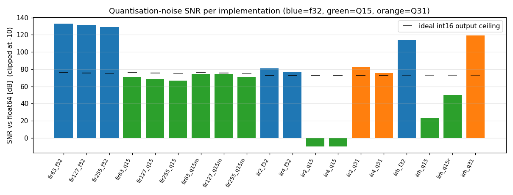
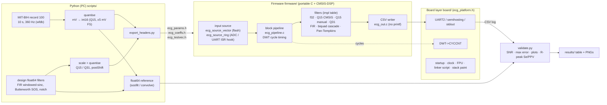
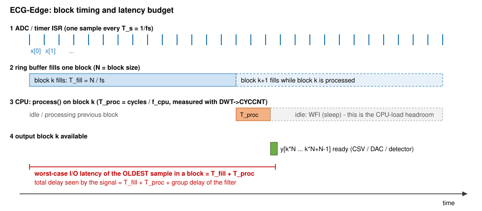
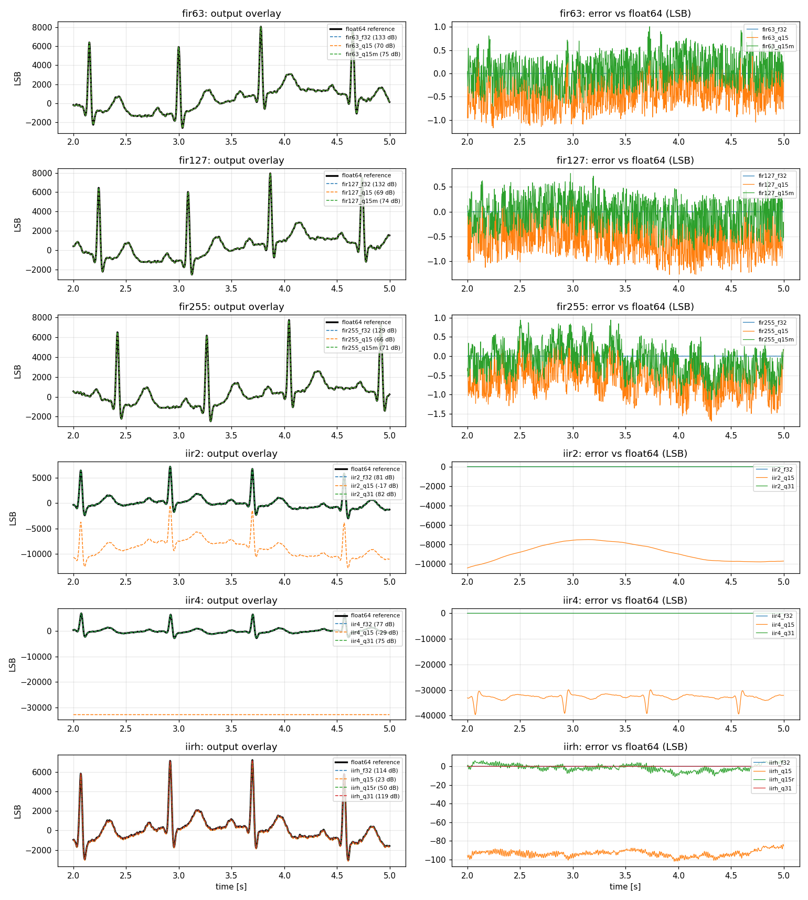
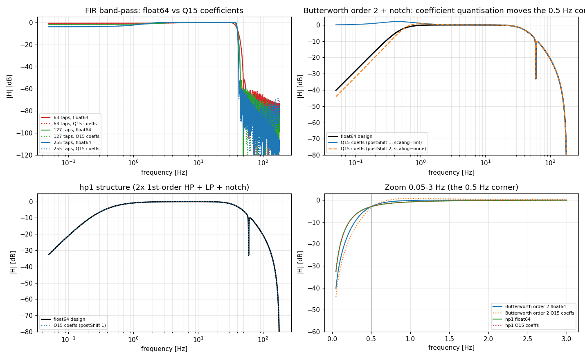
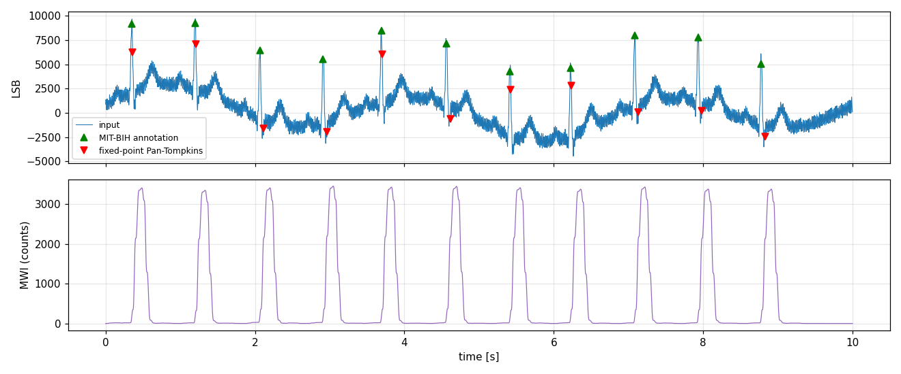

<div align="center">

<a id="top"></a>

# ⚡ ECG-Edge

### Real-time **fixed-point** ECG filtering on an ARM Cortex-M4 — proven against a Python reference

*What really happens to a 0.5–40 Hz ECG filter when you squeeze it into 16-bit integers?*


[🚀 Quick start](#quickstart) &nbsp;·&nbsp; [🔬 Key finding](#finding) &nbsp;·&nbsp; [🧮 Theory](#theory) &nbsp;·&nbsp; [📊 Results](#results) &nbsp;·&nbsp; [📚 References](#references)

</div>

---

## ✨ At a glance

ECG-Edge takes a classic ECG conditioning chain — **0.5–40 Hz band-pass + 60 Hz notch at 360 Hz** (MIT-BIH) — and implements it
as **FIR and IIR in float32, CMSIS Q15, hand-written Q15 and Q31**, running block-by-block on a Cortex-M4F. Every output sample is then
compared with a **double-precision Python reference**. It extends my Python project **ecg-dsp-toolkit** from
*"works in NumPy"* to *"works in 16-bit integers on a microcontroller — and I can prove exactly how wrong it is"*.

| | |
|---|---|
| 🧮 **20 implementations** | FIR (63/127/255 taps) and IIR × float32 · Q15 (CMSIS) · Q15 (hand-written, saturating) · Q31, plus a fixed-point **Pan–Tompkins** R-peak detector |
| ⏱️ **Measured, not guessed** | DWT cycle counter, block-size sweep, stack painting, flash/RAM from the linker map and per-implementation isolated builds |
| ✅ **Bit-exact verification** | The real Cortex-M4 binary (QEMU & Renode) gives *identical* integer outputs to the host build |
| 🔬 **A real failure, explained** | The textbook Butterworth Q15 IIR collapses at 0.5 Hz (−16.6 dB SNR) — root-caused with a bit-exact model and fixed two ways |
| 🔌 **Portable by design** | Hardware lives behind a 7-function interface; the ADC/UART input hook is already in place |

<a id="finding"></a>
### 🔬 The key finding

> [!IMPORTANT]
> **A 16-bit IIR is not just "a bit less accurate" than float — at a 0.5 Hz corner with fs = 360 Hz it is structurally broken.**
> One Q14 coefficient step (6.1·10⁻⁵) is the same size as `1 + a₁ + a₂` (7.7·10⁻⁵) for the 0.5 Hz poles, and CMSIS's truncation bias is
> amplified ≈ 12 900× inside the feedback loop. Q31, or a restructured filter with rounding, fixes it (details in [§5.6](#theory)).

<p align="center">
  
  <br><sub><b>SNR vs the float64 reference for every implementation.</b> Synthetic ECG, real Cortex-M4 code in QEMU — a pipeline sanity run, not MIT-BIH results (see §0).</sub>
</p>

| Structure | Arithmetic | SNR vs float64 |
|---|---|---|
| Butterworth band-pass + notch | CMSIS Q15 (truncating) | ❌ **−16.6 dB** |
| Butterworth band-pass + notch | Q31 | ✅ 82.4 dB |
| 2× first-order HP + LP + notch ("hp1") | CMSIS Q15 (truncating) | ⚠️ 23.1 dB |
| same | **hand-written Q15, rounding** | ✅ **50.1 dB** |
| same | Q31 | 🏆 119 dB |

<sub><i>Synthetic-ECG sandbox run on a simulated Cortex-M4 — re-run on MIT-BIH record 100 for your own numbers (see §0).</i></sub>

<details>
<summary><b>📑 Table of contents</b></summary>

0. [What's verified — and what's yours to measure](#status)
1. [System architecture](#architecture)
2. [Quick start](#quickstart)
3. [What each stage does](#stages)
4. [Software details](#details)
5. [Fixed-point theory](#theory)
6. [FIR design note](#fir-note)
7. [Pan–Tompkins R-peak detector](#pt)
8. [Validation method](#validation)
9. [Results](#results)
10. [Trade-offs](#tradeoffs)
11. [Troubleshooting](#troubleshooting)
12. [Known limitations](#limitations)
13. [📚 References](#references)

</details>

---

<a id="status"></a>
## ✅ 0. What's verified — and what's yours to measure

| Item | Status |
|---|---|
| Python export → C headers → firmware → CSV → validation pipeline | **Built and run end-to-end** (host, QEMU Cortex-M4, Renode Cortex-M4) |
| Integer outputs: real Cortex-M4 SIMD binary (QEMU/Renode) vs host C | **Bit-identical** for every Q15/Q31 implementation and the R-peak list |
| Flash / RAM per implementation (`footprint.py`) | **Measured** (arm-none-eabi-gcc 13.2.1, `-O2`, CMSIS-DSP v1.16.2) – table in §9 |
| Stack high-water mark | Measured under QEMU (840 B for the full run); re-measure on your board |
| MIT-BIH record 100 results | **Not run by me**: my sandbox could not reach PhysioNet. All example numbers use a *synthetic* ECG and are in `results/example_synthetic/` |
| Cycles/sample, latency, CPU load | **Not measured** (no hardware; QEMU/Renode have no DWT cycle counter). §9 tells you exactly how to get them and what range to expect |
| Real Nucleo board, ST-LINK flashing, UART capture | Code written to the register level and cross-compiled, **never run on silicon by me** |
| PlatformIO build | Config provided, **untested** (the CMake build is the tested path) |

> [!WARNING]
> Nothing in this README is a **hardware** measurement unless it says so. Where I give a number I did not measure,
> it is labelled *expected range* and comes with the reasoning.

### 📝 Assumptions (stated up-front, no questions asked)

1. **Board**: Nucleo-F411RE (Cortex-M4F, 128 KB RAM, 512 KB flash, ST-LINK virtual COM port on USART2/PA2). Your `[board]` placeholder was unspecified; any Cortex-M4F works – see §4.4 for porting.
2. **Clock**: default HSI 16 MHz (no PLL) so the first run needs no clock debugging. `-DECG_USE_PLL=1` selects 96 MHz (F411 only, untested).
3. **Sampling**: fs = 360 Hz, **60 Hz** notch (US mains, because MIT-BIH was recorded in the US). If you later feed a live ADC in India, change `NOTCH_HZ` in `scripts/common.py` to **50**.
4. **Amplitude convention**: int16 sample = Q15 with **±5 mV full scale** (1 LSB = 0.153 µV). Record-100 MLII peaks are roughly ±1–2 mV, leaving ~2.5× headroom for filter overshoot.
5. **Test signal**: first 10 s (3600 samples) of MIT-BIH `100`, channel 0 (MLII). Configurable (`--record --start --seconds`). Data come from the MIT-BIH Arrhythmia Database on PhysioNet [1][2]; they are downloaded at export time and **not** redistributed in this repo.
6. **Reference**: double precision, run on the *already int16-quantised* input, so the measured error isolates the *filter implementation*, not the ADC.
7. **IIR "complete chain"** = band-pass **+** notch (one extra biquad). The FIR chain is band-pass only (a 63-tap or longer Hamming FIR already puts 60 Hz in its stop-band).
8. **FIR lengths** 63 / 127 / 255 (odd, type-I linear phase; zero-padded by one tap internally because `arm_fir_q15` on Cortex-M4 requires an even count).

---

<a id="architecture"></a>
## 🗺️ 1. System architecture



<p align="center">
  
  <br><sub><b>Latency budget</b> (symbolic): T_fill = N/fs, T_proc = cycles/f_cpu, total delay = T_fill + T_proc + group delay.
  Linker notes: <a href="docs/linker_notes.md"><code>docs/linker_notes.md</code></a></sub>
</p>

**The key design rule:** `firmware/src` and `firmware/inc` (portable) know nothing about the chip. They talk to the
world only through `ecg_platform.h` (7 functions) and `ecg_source.h` (the input stream). A new board = one new
directory under `firmware/board/`.

```
ecg-edge/
├── README.md  Makefile  platformio.ini  requirements.txt
├── scripts/                      # Python: everything that runs on the PC
│   ├── common.py                 #   spec, filter design, Q-format quantisation, log parser (shared by all)
│   ├── export_headers.py         #   design → quantise → ecg_params.h / ecg_coeffs.h / ecg_testvec.h + reference.npz
│   ├── validate.py               #   MCU log vs float64: SNR, max error, plots, R-peak Se/PPV, results table
│   ├── footprint.py              #   per-implementation flash/RAM (isolated builds)
│   ├── map_report.py             #   flash/RAM/top symbols from the linker map
│   ├── plot_responses.py         #   |H(f)| float64 vs quantised coefficients
│   ├── diagnose_q15_iir.py       #   bit-exact Q15 biquad model: why the 0.5 Hz IIR fails
│   ├── capture_uart.py           #   record the ST-LINK COM port to a file
│   └── fetch_deps.sh  pio_extra.py
├── firmware/
│   ├── CMakeLists.txt  cmake/arm-none-eabi.cmake
│   ├── inc/  src/                # PORTABLE: pipeline, filters, detector, CSV writer, input sources
│   │   └── generated/            #   (created by export_headers.py – not committed)
│   ├── board/host/               # PC implementation of ecg_platform.h
│   ├── board/stm32f4/            # Cortex-M4: startup, clock/FPU, UART, DWT, stack painting, linker scripts (ld/)
│   ├── renode/                   # ecg_edge.resc + run_renode.sh
│   ├── sim/run_qemu.sh           # QEMU alternative
│   └── tests/test_ring.c         # unit test of the ADC/UART ring-buffer hook
├── results/                      # your run outputs go here;  example_synthetic/ = sandbox run (see its README)
├── docs/                         # block_diagram.mmd, timing_diagram.svg, linker_notes.md
└── third_party/                  # fetched: CMSIS-DSP v1.16.2, CMSIS_5 5.9.0 (Core), cmsis_device_f4 v2.6.10
```

### Implementation names (they are the keys in the CSV log and in the results table)

| Name | Arithmetic | Structure |
|---|---|---|
| `fir{63,127,255}_f32` | float32, FPU | `arm_fir_f32` |
| `fir{N}_q15` | Q15, 64-bit accumulate, **truncate** | `arm_fir_q15` (SIMD dual-MAC) |
| `fir{N}_q15m` | Q15, 32-bit **saturating** accumulate, **round** | hand-written (`ecg_fir_q15_manual.c`) |
| `iir{2,4}_f32` | float32 | `arm_biquad_cascade_df2T_f32`, Butterworth band-pass order 2/4 + notch |
| `iir{2,4}_q15` | Q15, truncate | `arm_biquad_cascade_df1_q15` (+postShift) – **fails, on purpose kept, see §5.6** |
| `iir{2,4}_q31` | Q31 | `arm_biquad_cascade_df1_q31` |
| `iirh_{f32,q15,q15r,q31}` | as named; `q15r` = hand-written, **rounding** | "hp1" structure: 2× first-order HP + LP + notch (Q15-friendly) |
| `pt_q15` | integer | band-pass 5–15 Hz → derivative → square → MWI → adaptive threshold |

---

<a id="quickstart"></a>
## 🚀 2. Quick start

### 2.1 Prerequisites

```bash
# Ubuntu/Debian/WSL
sudo apt install git cmake python3-pip gcc-arm-none-eabi libnewlib-arm-none-eabi
# optional simulators
sudo apt install qemu-system-arm                  # QEMU
#   Renode: https://github.com/renode/renode/releases  (v1.15.3 portable tarball was used)
# optional flashing: sudo apt install stlink-tools   (st-flash)   or openocd
pip install -r requirements.txt
./scripts/fetch_deps.sh                           # CMSIS-DSP / CMSIS-Core / STM32F4 device header, pinned versions
```
macOS: `brew install cmake arm-none-eabi-gcc qemu stlink`. Windows: use WSL2 (USB passthrough for ST-LINK via `usbipd`) or the Arm GNU toolchain + CMake + Ninja.

### 2.2 Export the data and coefficients (once)

```bash
python scripts/export_headers.py                  # real MIT-BIH record 100, first 10 s (downloads ~2 MB into data/)
# offline smoke test only (NOT a valid portfolio result):
python scripts/export_headers.py --source synthetic
# options: --record 100 --start 0 --seconds 10 --fir-taps 63 127 255 --iir-orders 2 4 --iir-scale linf|none
```
It prints the quantisation report (max |h|, L1 norm, postShift …) and writes
`firmware/inc/generated/*.h`, `results/reference.npz`, `results/meta.json`.

### 2.3 Path A — no hardware (host + QEMU/Renode)

```bash
# A1. host build: portable code on your PC (numerics only; timing is in ns, not cycles)
make host-run                                    # = cmake build + ./ecg_edge.elf + validate.py + unit test
# equivalent explicit commands:
cmake -S firmware -B build/host -DECG_TARGET=host -DCMAKE_BUILD_TYPE=Release
cmake --build build/host -j
./build/host/ecg_edge.elf > results/host_run.log
python scripts/validate.py --log results/host_run.log --label host

# A2. the REAL Cortex-M4 machine code, simulated – QEMU
make qemu-run
#   = cmake -S firmware -B build/qemu -DECG_TARGET=qemu -DCMAKE_TOOLCHAIN_FILE=$PWD/firmware/cmake/arm-none-eabi.cmake -DCMAKE_BUILD_TYPE=Release
#     cmake --build build/qemu -j  &&  ./firmware/sim/run_qemu.sh

# A3. same binary family in Renode (STM32F407 model, USART2 captured to a file)
export RENODE=/path/to/renode                    # omit if `renode` is on PATH
make renode-run
```
What simulators (QEMU, Renode [21]) can and cannot tell you:

* ✅ **Functional correctness**: they execute the real Thumb-2 + DSP-extension instructions, so Q15/Q31 integer results are bit-exact with silicon (I verified host == QEMU == Renode).
* ❌ **Cycle counts**: neither models `DWT->CYCCNT`. The firmware detects this (`#META,has_cycle_counter,0`) and `validate.py` prints `n/a` rather than fake numbers.
* ❌ Flash wait states / ART accelerator / bus contention – these change real cycle counts.

### 2.4 Path B — Nucleo-F411RE hardware

```bash
make nucleo                                      # 115200 baud, HSI 16 MHz  (≈ 75 s to stream the log)
#  or faster:   make nucleo-pll                  # 96 MHz core, 460800 baud (≈ 19 s) – see §10 if no output
# explicit form:
cmake -S firmware -B build/nucleo -DECG_TARGET=stm32f4 -DCMAKE_BUILD_TYPE=Release \
      -DCMAKE_TOOLCHAIN_FILE=$PWD/firmware/cmake/arm-none-eabi.cmake -DECG_UART_BAUD=115200
cmake --build build/nucleo -j                    # prints FLASH/RAM usage; produces ecg_edge.elf/.bin/.map

# flash (any one of):
st-flash --reset write build/nucleo/ecg_edge.bin 0x08000000
openocd -f interface/stlink.cfg -f target/stm32f4x.cfg -c "program build/nucleo/ecg_edge.elf verify reset exit"
cp build/nucleo/ecg_edge.bin /media/$USER/NODE_F411RE/       # drag-and-drop via ST-LINK mass storage

# capture the CSV (start BEFORE pressing the black RESET button; stops at #DONE)
python scripts/capture_uart.py --list
python scripts/capture_uart.py --port /dev/ttyACM0 --baud 115200 --out results/mcu_run.log    # Windows: COM5
python scripts/validate.py --log results/mcu_run.log --label mcu --cross results/host_run.log
python scripts/footprint.py                                              # per-implementation flash/RAM  (~1 min)
python scripts/map_report.py --map build/nucleo/ecg_edge.map --elf build/nucleo/ecg_edge.elf --log results/mcu_run.log
```
(If you use `nucleo-pll`, capture at `--baud 460800`.) The firmware runs **once** after every reset, prints
the log, then sleeps – press RESET to repeat.

### 2.5 PlatformIO option

```bash
pip install platformio
./scripts/fetch_deps.sh && python scripts/export_headers.py
pio run -e nucleo_f411re -t upload
pio device monitor -b 115200 --filter log2file          # or use scripts/capture_uart.py
```
**Untested by me.** PlatformIO's CMSIS framework brings its own startup/linker script/`system_stm32f4xx.c`, so those
files in `board/stm32f4/` are excluded (see `platformio.ini`). If the link fails with a missing `_ebss`/`_estack`,
add them to PlatformIO's linker script (`.ld`) – they are standard in ST's scripts, but check your framework version.

---

<a id="stages"></a>
## 🔍 3. What each stage does

<details>
<summary><b>Click to expand: the six stages, step by step</b></summary>


**Step 1 — Python design (`common.py`, `export_headers.py`).**
Golden filters are designed in float64: `firwin` (Hamming windowed-sinc, 0.5–40 Hz), `butter(...,'bandpass',output='sos')` (Butterworth response [15]), `iirnotch(60, Q=30)` — all via SciPy [20].
Then each is converted to the exact byte pattern the CMSIS function expects (§5): time-reversed + even-length FIR taps,
sign-flipped feedback coefficients, 6-per-stage layout for the Q15 biquad, `postShift`. The 10 s ECG segment is quantised to int16 and written
as a `static const int16_t[]`. Every spec number lives once in `common.py` and is copied into `ecg_params.h`, so firmware and reference cannot disagree.

**Step 2 — Firmware filters (`src/ecg_filters_*.c`).** One macro per family expands, for every tap count/order in the exported list, into
`{state buffer, init(), process()}`. Changing `--fir-taps` in Python changes the firmware with no C edits (X-macros).

**Step 3 — Pipeline (`ecg_pipeline.c`).** `source → process(block) → output buffer`. Block size is a run-time argument (≤ `ECG_MAX_BLOCK_SIZE`).
The stream is processed **twice**: pass 1 warms the flash prefetch/cache and is discarded, pass 2 is timed. Each `process()` call is bracketed by
two reads of `DWT->CYCCNT` [17]; the cost of the measurement itself (`#META,timing_overhead_cycles`) is subtracted. We keep total cycles
(→ cycles/sample), **maximum** block cycles (→ worst-case latency) and minimum.

**Step 4 — Input hook (`ecg_source.h`).** `ecg_source_vector` replays flash data (deterministic validation). `ecg_source_ring` is an SPSC ring buffer
that an ISR fills with `ecg_source_ring_push()`; wiring comments for TIM2→ADC1→ISR are in `ecg_source.h`. Switch by changing one line in `ecg_app.c`.

**Step 5 — Output (`ecg_out.c`).** CSV over UART (or semihosting under QEMU) with a hand-written number formatter (no `printf`, which would cost 10–20 KB flash and distort the footprint numbers).
Every implementation's output is printed in **int16-LSB units** (float ×32768, Q31 ÷2¹⁶, 3 decimals), so Python compares like with like.

**Step 6 — Validation (`validate.py`).** Checks the echoed input equals the exported vector bit-for-bit (catches stale headers),
then per implementation: `SNR = 10·log10(Σref² / Σ(y−ref)²)`, max |error|, bias, and the *ceiling* (SNR of simply rounding the exact answer to integers – no int16 implementation can beat it).

</details>

---

<a id="details"></a>
## 🧰 4. Software details

<details>
<summary><b>Click to expand: log format, stack, flash/RAM, porting</b></summary>


### 4.1 Log format (parsed by `common.parse_log`)
```
#META,key,value               #BEGIN,name,fmt,count  /  idx,value ... /  #END,name
#STAT,name,samples,blocks,block,total_cycles,max_block_cycles,min_block_cycles,rail_hits
#SWEEP,<same>                 (block-size sweep 1/4/16/36/64/128, timing only)
#PEAK,idx                     #STACK,used_bytes,total_bytes        #DONE
```
Samples are stored **by index**: a byte lost on the UART leaves a NaN hole that `validate.py` reports, instead of silently shifting the data.

### 4.2 Stack usage
`platform_stack_paint()` fills the free RAM (`_ebss` … SP−64) with `0xA5A5A5A5` at start; at the end `platform_stack_used()` scans upward for the first overwritten word.
No heap exists, so this is the complete dynamic-memory story. Result is printed as `#STACK,used,total`.

### 4.3 Flash and RAM
* Whole image: linker prints `FLASH:/RAM:` at every link; `map_report.py` parses the map and `arm-none-eabi-nm` for the biggest symbols.
* Per implementation: `footprint.py` builds a baseline with everything disabled, then one image per implementation, and subtracts (the `ECG_ENABLE_*` flags + `--gc-sections` make unused code vanish).

### 4.4 Porting to another Cortex-M4
Create `firmware/board/<yours>/` with `platform_cycles.h` (`return DWT->CYCCNT;`), a file implementing the functions in `ecg_platform.h`
(UART pins and clock tree are the only chip-specific parts), startup code and a linker script, and add the directory to `CMakeLists.txt`. Nothing in `src/` changes. For a Cortex-M7 add `-mcpu=cortex-m7 -mfpu=fpv5-d16`; for M0/M3 there is no DSP extension and no DWT cycle counter on M0 (use SysTick).

</details>

---

<a id="theory"></a>
## 🧮 5. Fixed-point theory

### 5.1 Q formats
Qm.n = signed integer interpreted as `value = int / 2ⁿ`. ARM/CMSIS write **Q1.15** (1 sign bit + 15 fraction bits = 16 bits, abbreviated **Q15**):
range [−1, 1−2⁻¹⁵], step 2⁻¹⁵ = 3.05×10⁻⁵. Q31 = 1.31. A Q15 value is not "a small integer": the integer −32768 *means* −1.0.
Our int16 ECG sample means `mV = int/32768 × 5`.

### 5.2 Multiplication, accumulation, scaling
* Q1.15 × Q1.15 = **Q2.30** in 32 bits (two sign bits). To return to Q15 shift right 15.
* Summing N products grows the value by up to log₂(N) bits (**guard bits**). `arm_fir_q15` accumulates in 64 bits (34.30) so this never overflows; our hand-written FIR uses a 32-bit Q30 accumulator that holds ±2.0, which is safe only if **Σ|h| < 2** (the L1 norm: worst-case input of full-scale, sign-matched samples).
  Our L1 norms are 1.64 (63 taps), 1.94 (127), **2.26 (255)** → the 255-tap manual FIR has *no guarantee* (real ECG never gets near it: `rail_hits` stays 0), which is exactly why it uses a **saturating** add.
* The one illegal product: (−1)×(−1) = +1 is not representable in Q15 → must saturate to 32767 (CMSIS does via `__SSAT`).

### 5.3 Saturation vs wrap-around
Two's-complement overflow **wraps**: 32767 + 1 → −32768, turning a slightly-too-large peak into a huge opposite-sign spike.
Saturation clamps instead (`SSAT`, `QADD`, `QSUB` are single-cycle instructions on Cortex-M4). Rule: **saturate at every point where a signal is narrowed or accumulated
in the same width**; widen the accumulator wherever it is free. `rail_hits` in the log counts output samples sitting on ±full-scale, a cheap overflow detector.

### 5.4 Quantisation noise and the 6 dB/bit rule
Rounding to a grid of step Δ adds error uniformly distributed in ±Δ/2: power Δ²/12 [13]. For a full-scale sine and B bits
`SQNR = 6.02·B + 1.76 dB` (98 dB for B=16): **each extra bit buys 6.02 dB** because it halves Δ (20·log₁₀2).
A real ECG uses only part of the range: with rms ≈ 0.05–0.1 of full scale you lose 20–26 dB, so the *ceiling* for an int16 output is ≈ 72–78 dB. That is the "ideal" column in `validate.py`.
Other noise sources: coefficient quantisation (moves poles/zeros: changes the *response*, not the noise), and **recursive feedback** (IIR) which amplifies rounding noise by the gain of 1/A(z).

### 5.5 FIR in Q15
Windowed-sinc taps are all |h| < 1 (max ≈ 0.2), so they fit Q15 directly with no scaling; coefficient error ≤ 2⁻¹⁶. The final `>>15` in CMSIS **truncates** (floor) → mean error −0.5 LSB
(visible as bias ≈ −0.45…−0.6 LSB in the results), and cost ≈ 4–6 dB of SNR versus rounding in my sandbox run. My manual FIR adds half an LSB before shifting.

### 5.6 IIR (biquad) in Q15 — coefficient scaling and `postShift`
**CMSIS conventions [16] (all handled in `common.py`):** equation `y[n] = b0x[n] + b1x[n-1] + b2x[n-2] + a1'y[n-1] + a2'y[n-2]` with **a1' = −a1, a2' = −a2** (opposite of scipy);
Q15 layout is **6 values/stage `{b0, 0, b1, b2, a1', a2'}`** (the 0 pads b0 into a SIMD word); state is 4 words/stage (`x[n-1], x[n-2], y[n-1], y[n-2]`).

**Why scaling is needed.** A Q15 coefficient must satisfy |c| < 1, but a low-frequency pole pair has a1' = 2r·cos θ ≈ **1.98**.
CMSIS therefore takes a `postShift` p: stored integer `q = round(c · 2^(15−p))`, and the kernel computes `y = (Σ q·s) >> (15−p)`, so the real coefficient is `q·2^p / 2^15`.
`p = 1` ⇒ Q14 (range ±2), `p = 2` ⇒ Q13 (±4). `choose_post_shift()` picks the smallest p with max|c| < 2^p. The price: each +1 in p costs **one coefficient bit** (precision halves).

**Section scaling.** (L∞/Lp-norm scaling follows Jackson [11].) `--iir-scale linf` divides each section's numerator by that section's peak gain and puts the product back into the last section – the overall transfer function is unchanged, but no inner node can exceed the input level (no clipping inside the cascade) and inner signals stay as large as safely possible. For Butterworth order 4 this pushed the last section above 2.0 and forced p=2; `--iir-scale none` is provided to compare. Both fail the same way (below).

**What actually happens at 0.5 Hz / fs = 360 Hz (measured, bit-exact model in `scripts/diagnose_q15_iir.py`):**

| Structure | Arithmetic | SNR vs float64 | Why |
|---|---|---|---|
| Butterworth band-pass+notch, order 2 | CMSIS Q15 (truncate) | **−16.6 dB** (bias ≈ −8000 LSB) | see below |
| same, order 4 | CMSIS Q15 | −28.5 dB, output pinned to the rail | same |
| same | Q31 (`iir2_q31`) | 82.4 dB | 2¹⁶× finer coefficients and state |
| same | float32 | 80.8 dB | even float32 loses ~30 dB vs the better structure |
| **hp1**: 2×1st-order HP + LP + notch | CMSIS Q15 | 23.1 dB (42.3 dB with DC removed) | truncation bias × 115 |
| same | **hand-written Q15, rounding** (`iirh_q15r`) | **50.1 dB** | bias ≈ −1.3 LSB |
| same | Q31 / float32 | 119 dB / 114 dB | |

(All on the synthetic segment; rerun on record 100 for your numbers.)

The failure of the Butterworth Q15 IIR is **structural**, not a bug (Q31 with identical coefficient conventions works). The ingredients — coefficient sensitivity near z = 1, round-off noise amplified by the loop gain, and dynamic-range scaling — are classical results in finite-word-length filter theory [10][11][12]:

1. The 0.5 Hz poles sit at radius ≈ 0.991. For that section `A(1) = 1 + a1 + a2 = 7.7×10⁻⁵` and the DC gain of the feedback path is `1/A(1) ≈ 12 900`.
2. One Q14 coefficient step is 6.1×10⁻⁵ ≈ A(1): **a single LSB of rounding in a1 or a2 changes the DC gain by ~80 %** – the pole position is essentially random (`plot_responses.py` shows the corner moving).
3. CMSIS truncates; the −0.5 LSB bias is injected *inside* the recursion and multiplied by 12 900 → thousands of LSB of DC offset (the plots show it as a huge constant shift).

Remedies, in the order I would try them: (a) **Q31** biquads (`iirK_q31`: more flash/cycles but ≈ float quality); (b) **change the structure** so no direct-form section has poles that close to z=1: two first-order high-passes (`iirh`), whose single real pole at R ≈ 0.994 is only 0.3 % off in Q15 – with **rounding** instead of truncation this reaches 50 dB; (c) a high-pass implemented as *subtract a slow running mean* (not implemented); (d) error-feedback ("noise shaping") or 32-bit state with 16-bit coefficients (`arm_biquad_cas_df1_32x64_q31`, not implemented).
The hp1 filter is *not* the Butterworth you designed (its high-pass is double real pole instead of Butterworth pair): it is a deliberate engineering trade-off, and the reference for `iirh` is its own float64 design.

### 5.7 DF1 vs DF2T
Direct form I (used for fixed point): feed-forward and feedback parts are separate, so one 64-bit accumulator sums all 5 products with no intermediate overflow, and state holds real signal values.
Transposed DF2 (used for float): only 2 state words/section and good float behaviour, but its internal states are not signal-sized and can overflow in fixed point.

---

<a id="fir-note"></a>
## 📉 6. FIR design note: why 0.5 Hz is awkward for a FIR
A Hamming-windowed FIR has a transition width ≈ 3.3·fs/N [10][14]. For a 0.5 Hz edge you would need N ≈ 2400 taps; with N = 255 the transition is ≈ 4.7 Hz wide, so
the high-pass edge is soft: baseline wander (a slow electrode/respiration artefact [9]) below ≈ 2 Hz is only partly removed and the response at 0.5 Hz is far from −3 dB. That is a *design* limitation, not a *quantisation* one;
`validate.py` measures only the latter (vs the same filter in float64), and `plot_responses.py` shows the former. Group delay is (N−1)/2 samples: 86 / 175 / 353 ms for 63 / 127 / 255 taps
– too long for beat-by-beat feedback, fine for display/storage. Long FIRs are cheap in cycles but expensive in latency; IIR is the opposite. Phase matters clinically: aggressive high-pass filtering with non-linear phase can distort the ST segment, which is why the ECG standards discuss bandwidth and filter phase explicitly [7][8].

---

<a id="pt"></a>
## 💓 7. Optional stretch: Pan–Tompkins R-peak detector (`ecg_pan_tompkins.c`)
Integer-only chain after Pan & Tompkins [3] and Hamilton & Tompkins [4]: 5–15 Hz Butterworth (2 biquads, Q15) → 5-point derivative → squaring (kept in 32 bit, `>>6`, **not** shifted back to Q15 – QRS slopes are only hundreds of LSB, a Q15 square would have 3–4 bits of resolution) →
150 ms moving-window integral (54 samples @ 360 Hz) → adaptive thresholds (SPKI/NPKI, THR1 = NPKI + ¼(SPKI−NPKI)), 200 ms refractory, T-wave rejection (slope < ½ of the previous QRS), search-back at 1.66×RR. R location is refined by an arg-max on the band-passed signal.
Not implemented: the 2 s learning phase and the second threshold pair of the original paper.

**Evaluating it properly.** 10 s contains only ~10–15 beats, so Se/PPV there is anecdotal. Use the host build on a long record (the host can hold the whole 30-min record; the MCU cannot):
```bash
python scripts/export_headers.py --seconds 1800 --out-dir build/gen_long --results-dir results/long     # ~650 k samples
cmake -S firmware -B build/host_long -DECG_TARGET=host -DECG_GEN_DIR=$PWD/build/gen_long -DCMAKE_BUILD_TYPE=Release && cmake --build build/host_long -j
./build/host_long/ecg_edge.elf --pt-only > results/long/pt.log
python scripts/validate.py --log results/long/pt.log --reference results/long/reference.npz --meta results/long/meta.json \
                           --out-dir results/long --label pt --tol-ms 150
```
`validate.py` counts only *beat* annotation symbols (`N L R B A a J S V r F e j n E / f Q ?`), matches each to the nearest detection within ±150 ms (the AAMI EC57 convention [6]) and reports TP/FP/FN, sensitivity Se = TP/(TP+FN), PPV = TP/(TP+FP) and the mean detection offset
(≈ the band-pass group delay; subtract it if you need sample-accurate R positions). For context: Pan & Tompkins reported 99.3 % of QRS complexes detected [3]; a later comparison reports 99.68 % sensitivity / 99.63 % positive predictivity for the Hamilton–Tompkins variant on a standard dataset [4][5]. Record 100 is generally regarded as a clean record, so **report what *you* measure, not these figures**.

---

<a id="validation"></a>
## 🧪 8. Validation method
* **SNR** = 10·log₁₀(Σ ref² / Σ (y − ref)²), all in int16-LSB units; also reported with the error's DC removed (`SNR, DC removed`) because a constant offset is harmless for AC-coupled ECG but dominates the plain SNR when bias is large.
* **Ceiling** = same formula for `round(ref)`: the best any int16 output can do on this signal.
* **ENOB** = (SNR − 1.76)/6.02 is in the CSV.
* **Max abs error** in LSB and µV (1 LSB = 0.1526 µV). For scale: a P wave is on the order of 100 µV ≈ 650 LSB, so a 1–2 LSB error is ≈ 0.15–0.3 µV.
* `--cross host_run.log` verifies the MCU's integer outputs are *bit-identical* to the host build (float rows may differ by < 1 LSB because of FMA/summation order).
* Overlays (`*_overlay.png`), SNR bars (`*_snr.png`), block-size sweep (`*_block_sweep.png`, hardware only), R-peak plot (`*_peaks.png`) and frequency responses (`freq_responses.png`).

---

<a id="results"></a>
## 📊 9. Results

### 9.1 What I measured (sandbox: synthetic ECG, QEMU Cortex-M4, flash/RAM via `footprint.py`)
*Data-dependent columns (SNR) are for the synthetic signal – do not quote. Flash/RAM Δ are measured and are independent of the data; they are the **stand-alone** cost of
each implementation over a framework-only baseline of **13 344 B flash / 19 024 B RAM** (7 200 B of that flash is the test vector; 14 400 B of the RAM is the shared output buffer).*

| Implementation | flash Δ (B) | RAM Δ (B) | SNR (dB) | SNR, DC removed (dB) | max abs err (LSB) | bias (LSB) | cycles/sample | CPU load @360 Hz |
|---|---|---|---|---|---|---|---|---|
| `fir63_f32` | 560 | 776 | 133.2 | 133.2 | 0.00 | +0.00 | *measure* | *measure* |
| `fir127_f32` | 816 | 1032 | 131.6 | 131.6 | 0.00 | +0.00 | *measure* | *measure* |
| `fir255_f32` | 1328 | 1544 | 129.1 | 129.1 | 0.01 | +0.00 | *measure* | *measure* |
| `fir63_q15` | 464 | 392 | 70.4 | 74.8 | 1.33 | -0.45 | *measure* | *measure* |
| `fir127_q15` | 592 | 520 | 68.7 | 74.3 | 1.39 | -0.55 | *measure* | *measure* |
| `fir255_q15` | 848 | 776 | 66.5 | 70.8 | 1.92 | -0.59 | *measure* | *measure* |
| `fir63_q15m` | 588 | 384 | 74.5 | 74.6 | 1.13 | +0.05 | *measure* | *measure* |
| `fir127_q15m` | 716 | 512 | 74.3 | 74.4 | 0.95 | -0.05 | *measure* | *measure* |
| `fir255_q15m` | 976 | 768 | 70.6 | 70.8 | 1.39 | -0.09 | *measure* | *measure* |
| `iir2_f32` | 368 | 32 | 80.8 | 80.8 | 0.36 | +0.00 | *measure* | *measure* |
| `iir4_f32` | 408 | 48 | 76.5 | 76.6 | 0.45 | -0.01 | *measure* | *measure* |
| `iir2_q15` | 456 | 40 | -16.6 | -4.4 | 11633.22 | -8262.94 | *measure* | *measure* |
| `iir4_q15` | 480 | 56 | -28.5 | -14.7 | 39612.84 | -31034.58 | *measure* | *measure* |
| `iir2_q31` | 452 | 64 | 82.4 | 97.5 | 0.10 | -0.09 | *measure* | *measure* |
| `iir4_q31` | 492 | 96 | 75.3 | 90.6 | 0.26 | -0.20 | *measure* | *measure* |
| `iirh_f32` | 388 | 40 | 114.0 | 114.0 | 0.01 | -0.00 | *measure* | *measure* |
| `iirh_q15` | 468 | 48 | 23.1 | 42.3 | 108.95 | -92.10 | *measure* | *measure* |
| `iirh_q15r` | 412 | 32 | 50.1 | 50.5 | 14.72 | -1.30 | *measure* | *measure* |
| `iirh_q31` | 472 | 80 | 119.1 | 131.7 | 0.00 | -0.00 | *measure* | *measure* |
| `pt_q15` (detector) | 1396 | 1356 | - | - | - | - | *measure* | *measure* |

Whole image with everything enabled (Nucleo-F411RE build): **22 464 B flash (4.3 % of 512 KB), 23 600 B static RAM (18 %), stack high-water 840 B** (QEMU) → ≈ 24.4 KB RAM.
Full detail: `results/example_synthetic/map_report_nucleo.md`.

Reading the table:
* **FIR f32 ≈ 130 dB** vs the float64 reference: float32's own error (not a bug – 24-bit mantissa).
* **CMSIS Q15 FIR sits ≈ 4–6 dB below the manual FIR** (truncation bias −0.5 LSB vs rounding); both are within ~2–6 dB of the 74–76 dB int16 ceiling. SNR drifts down slightly with FIR length (more terms, longer coefficient set).
* **`iirK_q15` is unusable at this corner (§5.6)**; `iirh_q15r` (50 dB) and `iirK_q31` (75–82 dB) are the working fixed-point IIRs.
* **FIR Q15 RAM** is dominated by CMSIS state (`numTaps+block` words) – Q15 halves it vs float.

<details>
<summary><b>🖼️ Plots from the sandbox run (synthetic ECG, simulated Cortex-M4)</b></summary>

<p align="center">
  <br>
  <sub><b>Overlays and error traces.</b> Note the huge DC offset of the Butterworth Q15 rows (orange) versus the well-behaved hp1 rows.</sub>
</p>
<p align="center">
  <br>
  <sub><b>Frequency responses</b>, float64 design vs quantised coefficients — bottom-right zooms on the 0.5 Hz corner.</sub>
</p>
<p align="center">
  <br>
  <sub><b>Fixed-point Pan–Tompkins</b> detections vs annotations (synthetic signal: pipeline check only).</sub>
</p>

</details>

### 9.2 What YOU must fill in: cycles, latency, CPU load (hardware)
Run §2.4. `validate.py` then writes `results/mcu_results_table.md` with every column below filled in from the DWT counter. How each number is obtained:

| Column | Source | Formula |
|---|---|---|
| cycles/sample | `#STAT … total_cycles / samples` (2nd, warm pass; measurement overhead removed) | – |
| CPU load @ 360 Hz | derived | `cycles_per_sample × 360 / f_cpu × 100 %` |
| worst block (ms) | `max_block_cycles` | `/ f_cpu × 1000` |
| I/O latency (ms) | derived | `N/fs·1000 + worst block ms`  (N = 36 → 100 ms fill) |
| group delay (ms) | exported by Python | FIR (N−1)/2/fs; IIR at 10 Hz |
| flash / RAM | `footprint.py` | as §4.3 |
| error (dB) | `validate.py` | §8 |

`f_cpu` = `#META,cpu_hz` (16 MHz default; 96 MHz with `ECG_USE_PLL=1`).

**Expected ranges** (plausibility bands from instruction counts of the inner loops on a Cortex-M4F with zero/low wait states; *not* measurements. If you land more than ~3× outside, suspect a wrong clock, `-O0`, a Debug build, caches/ART disabled or the wrong `cpu_hz`):

| Implementation | Expected cycles/sample |
|---|---|
| `fir{N}_q15` (SMLALD dual-MAC) | ≈ (0.5 … 1.5) × N  |
| `fir{N}_f32` (VMLA) | ≈ (1 … 3) × N  |
| `fir{N}_q15m` (manual, QADD per tap) | ≈ (4 … 8) × N  → several × slower than `_q15` |
| `iirK_*` per section | Q15 ≈ 12–25, f32 DF2T ≈ 8–20, Q31 ≈ 20–40 cycles; multiply by the number of sections (3 or 5; `iirh` 4) |
| `pt_q15` | ≈ 100 … 300 |
| timing overhead (`#META`) | ≈ 1 … 4 cycles |

**Worked CPU-load arithmetic (hypothetical numbers, to show the formula):** if `fir255_q15` needed 300 cycles/sample at 16 MHz, load = 300 × 360 / 16 000 000 = 0.68 %. At fs = 360 Hz even the slowest implementation here should leave > 90 % idle; the interesting comparison is **energy** (idle % ⇒ sleep time) and **latency**, not feasibility.
Block-size sweep: expect cycles/sample to fall steeply from block = 1 to ≈ 16 (call + state load/store overhead amortised) and flatten after; the curve is in `*_block_sweep.png`.

---

<a id="tradeoffs"></a>
## ⚖️ 10. Trade-offs: accuracy vs speed vs memory

| Choice | Accuracy | Speed | Memory | Latency |
|---|---|---|---|---|
| float32 FIR/IIR | best (≥ 110 dB) | FPU: fast; **needs an FPU** (M4F/M7) | 2× Q15 | – |
| Q15 CMSIS FIR | ≈ 66–71 dB (≈ int16 ceiling − 5 dB) | fastest (SIMD) | smallest | FIR delay (N−1)/2 |
| Q15 manual FIR (round + saturate) | ≈ ceiling − 1…4 dB | several × slower | small | same |
| Q31 | ≥ float | ≈ 1.5–2× Q15 | 2× | – |
| IIR vs FIR | IIR: 5–6 coefficients/section, tiny state, **but** ill-conditioned at 0.5 Hz | IIR ≈ 3–15× fewer cycles than a 255-tap FIR (expected: ≈3× vs Q15, ≈15× vs f32 – measure) | IIR ≪ FIR | IIR ≈ 7–13 ms vs FIR 86–353 ms; IIR is non-linear-phase (distorts ST segment morphology) |
| Block size | – | larger = lower overhead/sample | state ∝ block | latency ∝ block (N/fs) |

Rule of thumb from this project: **fixed-point is "free" for FIRs, treacherous for narrow, low-frequency IIRs**; choose the arithmetic *after* looking at the pole radius.

---

<a id="troubleshooting"></a>
## 🛠️ 11. Troubleshooting

<details>
<summary><b>Click to expand: symptom → cause → fix</b></summary>


| Symptom | Likely cause / fix |
|---|---|
| CMake: `Missing third_party/...` or `Missing .../ecg_params.h` | run `./scripts/fetch_deps.sh` and `python scripts/export_headers.py` |
| `export_headers.py` cannot download | PhysioNet blocked/offline: copy `100.dat 100.hea 100.atr` into `data/mitdb/`, or use `--source synthetic` for a smoke test only |
| No UART output | wrong port (`capture_uart.py --list`); started capture *after* reset (the program runs once – press RESET again); baud mismatch (`-DECG_UART_BAUD` must equal `--baud`); with `nucleo-pll` capture at 460800; jumpers/ST-LINK VCP driver on Windows |
| Garbage characters / `validate.py` reports missing samples | baud error: HSI is ±1 %; try 115200 (not 460800) without the PLL; use a short USB cable |
| Immediately HardFaults / works in debug only | FPU not enabled (CPACR) – done in `SystemInit`; if you replaced startup, copy that line. Also never run the QEMU/semihosting build on hardware (BKPT without debugger faults) |
| `validate.py`: "input echo differs" | stale headers: re-run export **and rebuild** |
| `has_cycle_counter,0` on real hardware | some debug configs gate DWT; the firmware sets `TRCENA` itself – if still 0, a debugger session may have disabled trace (reset the board with the debugger detached) |
| Cycle counts 3–10× above expectation | `-O0` / Debug build (`-DCMAKE_BUILD_TYPE=Release`), flash wait states with ART disabled, wrong `cpu_hz`, or `ARM_MATH_DSP` not defined (check `-mcpu=cortex-m4`) |
| `iirK_q15` SNR is terrible | expected – §5.6 explains it; look at `iirh_q15r` / `iirK_q31` |
| `arm_fir_init_q15` returns error / FIR output is zero | tap count must be even (the exporter pads) – only matters if you hand-edit headers |
| Linker: `region RAM overflowed` | lower `--seconds` (output buffer = N×4 B) or disable groups with `-DECG_ENABLE_*=0` |
| Renode: floods of `0xE0001004` warnings | DWT not modelled; the script sets `logLevel 3` to hide them. Cycle counts from Renode are meaningless |
| Renode prints `Failed to download ... .svd.gz` | it tries to fetch a peripheral-description file; harmless offline – the run proceeds |
| Renode: log empty | `CreateFileBackend` needs an absolute path: use `run_renode.sh`; check `$RENODE` |
| QEMU prints nothing on stdout | semihosting console goes to **stderr** (`2> results/qemu_run.log`) |

</details>

---

<a id="limitations"></a>
## ⚠️ 12. Known limitations
* Not run on real silicon or on real MIT-BIH data by the author of this scaffold; the synthetic-data numbers are for pipeline checking only.
* QEMU/Renode give functional results, not timing.
* `ECG_USE_PLL=1` (96 MHz) and the PlatformIO config are untested.
* The FIR high-pass edge at 0.5 Hz is soft by construction (§6).
* Pan-Tompkins thresholds (`PT_MIN_THR`) are in absolute counts for the ±5 mV full-scale convention; change them if you change the scaling.
* **Not implemented (stretch goal):** an int8 ECG beat classifier from my `ecg-ml` project, via CMSIS-NN [18] / integer-only inference [19].
* CMSIS-DSP's generic C kernels (host) and SIMD kernels (M4) produced identical integers *here*; other CMSIS-DSP versions may differ in rounding details – keep the pinned versions.

Licence: MIT for this repository's code; CMSIS-DSP/CMSIS-Core are Apache-2.0; STM32 device headers are under ST's licence; MIT-BIH data are under the PhysioNet Open Data licence.

---

<a id="references"></a>
## 📚 13. References

> **How to read this list.** ✅ = I looked the entry up online while preparing this README (title, venue, year, DOI/identifier).
> 📖 = standard textbook / standard document cited from my knowledge, *not* re-checked — confirm volume and page details in your library
> before citing it in a formal paper. This project **combines** these sources; it does not claim to reproduce any single paper's numbers.

### 💡 Where the idea comes from

1. **My own `ecg-dsp-toolkit`.** The filter specification (0.5–40 Hz FIR/Butterworth band-pass + 60 Hz notch at 360 Hz) comes from it. ECG-Edge asks the next question: *what happens to exactly these filters in 16-bit integer arithmetic on a microcontroller?*
2. **The classic embedded-ECG lineage.** Pan & Tompkins designed their QRS detector to run in real time without heavy computation [3] — the same constraint a Cortex-M faces. Hamilton & Tompkins refined it on the MIT-BIH database [4]. The fixed-point `pt_q15` module follows this line.
3. **Finite-word-length filter theory.** Coefficient sensitivity, round-off noise and dynamic-range scaling [10][11][12][13] explain *why* the Q15 Butterworth IIR fails at 0.5 Hz — the project's central finding.
4. **The ARM DSP ecosystem.** CMSIS-DSP supplies the Q15/Q31 kernels and their conventions (`postShift`, coefficient layout); CMSIS-NN [18] and integer-only inference [19] motivate the int8 classifier stretch goal.

### 🫀 ECG data and benchmarking

| # | | Reference |
|---|---|---|
| [1] | ✅ | G. B. Moody and R. G. Mark, "The impact of the MIT-BIH Arrhythmia Database," *IEEE Engineering in Medicine and Biology Magazine*, vol. 20, no. 3, pp. 45–50, 2001. doi:[10.1109/51.932724](https://doi.org/10.1109/51.932724) |
| [2] | ✅ | A. L. Goldberger *et al.*, "PhysioBank, PhysioToolkit, and PhysioNet: Components of a new research resource for complex physiologic signals," *Circulation*, vol. 101, no. 23, pp. e215–e220, 2000. doi:[10.1161/01.CIR.101.23.e215](https://doi.org/10.1161/01.CIR.101.23.e215) |

### 💓 QRS detection

| # | | Reference |
|---|---|---|
| [3] | ✅ | J. Pan and W. J. Tompkins, "A real-time QRS detection algorithm," *IEEE Transactions on Biomedical Engineering*, vol. BME-32, no. 3, pp. 230–236, Mar. 1985. doi:[10.1109/TBME.1985.325532](https://doi.org/10.1109/TBME.1985.325532) |
| [4] | ✅ | P. S. Hamilton and W. J. Tompkins, "Quantitative investigation of QRS detection rules using the MIT/BIH arrhythmia database," *IEEE Transactions on Biomedical Engineering*, vol. BME-33, pp. 1157–1165, 1986. |
| [5] | ✅ | N. M. Arzeno, Z.-D. Deng and C.-S. Poon, "Analysis of first-derivative based QRS detection algorithms," *IEEE Transactions on Biomedical Engineering*, vol. 55, no. 2, pp. 478–484, Feb. 2008. |
| [6] | 📖 | ANSI/AAMI EC57:2012, *Testing and reporting performance results of cardiac rhythm and ST segment measurement algorithms* (beat-matching convention used for sensitivity / PPV). |

### 〰️ ECG bandwidth and pre-processing

| # | | Reference |
|---|---|---|
| [7] | ✅ | P. Kligfield *et al.*, "Recommendations for the standardization and interpretation of the electrocardiogram — Part I: The electrocardiogram and its technology," *Circulation*, vol. 115, pp. 1306–1324, 2007 (co-published in *J. Am. Coll. Cardiol.*, doi:[10.1016/j.jacc.2007.01.024](https://doi.org/10.1016/j.jacc.2007.01.024)). Context for ECG bandwidth and digital filtering. |
| [8] | 📖 | J. J. Bailey *et al.*, "Recommendations for standardization and specifications in automated electrocardiography: bandwidth and digital signal processing," *Circulation*, vol. 81, no. 2, pp. 730–739, 1990. |
| [9] | 📖 | L. Sörnmo and P. Laguna, *Bioelectrical Signal Processing in Cardiac and Neurological Applications*, Elsevier Academic Press, 2005. |

> **Note on the band used here.** 0.5–40 Hz is a *monitoring-style* band, narrower than the diagnostic bandwidths discussed in [7][8]; aggressive high-pass filtering can distort the ST segment, which is why this project reports the FIR/IIR group delay and phase behaviour explicitly (§6, §10).

### 🧮 Fixed-point filter theory

| # | | Reference |
|---|---|---|
| [10] | 📖 | A. V. Oppenheim and R. W. Schafer, *Discrete-Time Signal Processing*, 3rd ed., Pearson, 2010 — finite-precision effects: coefficient quantisation, round-off noise, limit cycles. |
| [11] | ✅ | L. B. Jackson, "On the interaction of roundoff noise and dynamic range in digital filters," *Bell System Technical Journal*, vol. 49, no. 2, 1970 — L<sub>p</sub>-norm dynamic-range scaling (basis of this project's `--iir-scale linf`). |
| [12] | ✅ | L. B. Jackson, "Roundoff noise bounds derived from coefficient sensitivities for digital filters," *IEEE Transactions on Circuits and Systems*, vol. 23, no. 8, pp. 481–485, 1976. doi:[10.1109/TCS.1976.1084247](https://doi.org/10.1109/TCS.1976.1084247) — links coefficient sensitivity to round-off noise (cf. §5.6, poles near z = 1). |
| [13] | 📖 | B. Widrow and I. Kollár, *Quantization Noise: Roundoff Error in Digital Computation, Signal Processing, Control, and Communications*, Cambridge University Press, 2008 — Δ²/12 model, ≈ 6 dB per bit. |
| [14] | 📖 | F. J. Harris, "On the use of windows for harmonic analysis with the discrete Fourier transform," *Proceedings of the IEEE*, vol. 66, no. 1, pp. 51–83, 1978 — window design (Hamming windowed-sinc FIR). |
| [15] | 📖 | S. Butterworth, "On the theory of filter amplifiers," *Wireless Engineer*, vol. 7, pp. 536–541, 1930. |

### 🔧 Embedded implementation and ML

| # | | Reference |
|---|---|---|
| [16] | ✅ | Arm, **CMSIS-DSP v1.16.2** — documentation and source (read for the Q15/Q31 `postShift` semantics, biquad coefficient layout and truncating shift). <https://github.com/ARM-software/CMSIS-DSP> |
| [17] | 📖 | Arm, *ARMv7-M Architecture Reference Manual* (DDI 0403) — DWT cycle counter, DSP-extension instructions (`SMLALD`, `QADD`, `SSAT`). |
| [18] | ✅ | L. Lai, N. Suda and V. Chandra, "CMSIS-NN: Efficient neural network kernels for Arm Cortex-M CPUs," arXiv:[1801.06601](https://arxiv.org/abs/1801.06601), 2018. |
| [19] | 📖 | B. Jacob *et al.*, "Quantization and training of neural networks for efficient integer-arithmetic-only inference," *IEEE/CVF CVPR*, 2018 — int8 quantisation scheme behind the planned classifier. |

### 🧰 Tools

| # | | Reference |
|---|---|---|
| [20] | 📖 | P. Virtanen *et al.*, "SciPy 1.0: fundamental algorithms for scientific computing in Python," *Nature Methods*, vol. 17, pp. 261–272, 2020. (`firwin`, `butter`, `iirnotch`, `sosfilt`) |
| [21] | 📖 | QEMU — <https://www.qemu.org> · Renode (Antmicro) — <https://renode.io> · `wfdb` Python package — <https://github.com/MIT-LCP/wfdb-python> |

### ✍️ Cite this project

```bibtex
@software{ecg_edge,
  author = {shaurXePo},
  title  = {ECG-Edge: real-time fixed-point ECG filtering on an ARM Cortex-M4},
  year   = {2026},
  url    = {https://github.com/shaurXePo/ecg-edge}
}
```

---

<div align="center">

**⚡ ECG-Edge** · built by [shaurXePo](https://github.com/shaurXePo) · [⬆ back to top](#top)

</div>
